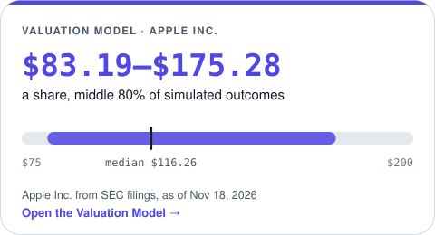
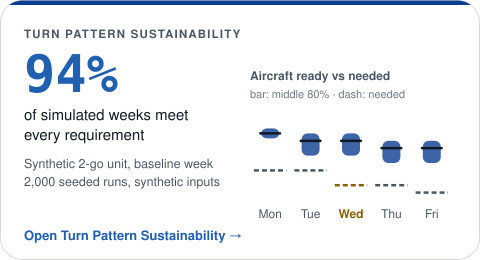

## Know the odds before you commit.

**Jason C. Courtoy** · Open decision models for operations, capital allocation and deals.

[Portfolio](https://courtizy.github.io/) · [LinkedIn](https://www.linkedin.com/in/jasoncourtoy/)

<a href="https://courtizy.github.io/valuation/"><picture><source media="(prefers-color-scheme: dark)" srcset="previews/valuation-dark.svg"></picture></a>
<a href="https://courtizy.github.io/TPS-Monte-Carlo-Simulation/"><picture><source media="(prefers-color-scheme: dark)" srcset="previews/tps-dark.svg"></picture></a>

Drawn from each model's published results and redrawn daily.

| | Project | The question it answers | Status |
|:-:|---|---|---|
|  | **[Valuation Model](https://courtizy.github.io/valuation/)** Deals · DCF · Comparables · [demo](https://courtizy.github.io/valuation/?demo=1) · [code](https://github.com/Courtizy/valuation) | What is a public company worth across plausible assumptions? | Live |
|  | **[Turn Pattern Sustainability](https://courtizy.github.io/TPS-Monte-Carlo-Simulation/)** Operations · Simulation · [code](https://github.com/Courtizy/TPS-Monte-Carlo-Simulation) | How often can the fleet fly the weekly schedule? | Live |
|  | **Project ROI** Capital · Optimization | Which projects earn funding under real limits? | Planned |
|  | **Shared Core** Foundation · Monte Carlo | How likely is each outcome? A shared engine is planned; today each model runs its own. | Planned |

Side project: **[Delta Readiness](https://courtizy.github.io/fitness/)** asks "Am I ready for the PT test?" It is a daily readiness and PT-score tracker built on the same idea.

**Decisions. Probabilities. Limits.** Every model starts from one real question, shows the odds instead of a single number, and says what it can't tell you.

Personal projects, built on personal time. Views are my own. Public or synthetic data only; not endorsed by DoD or the U.S. Air Force. The Valuation Model is analysis of method, not investment advice.
